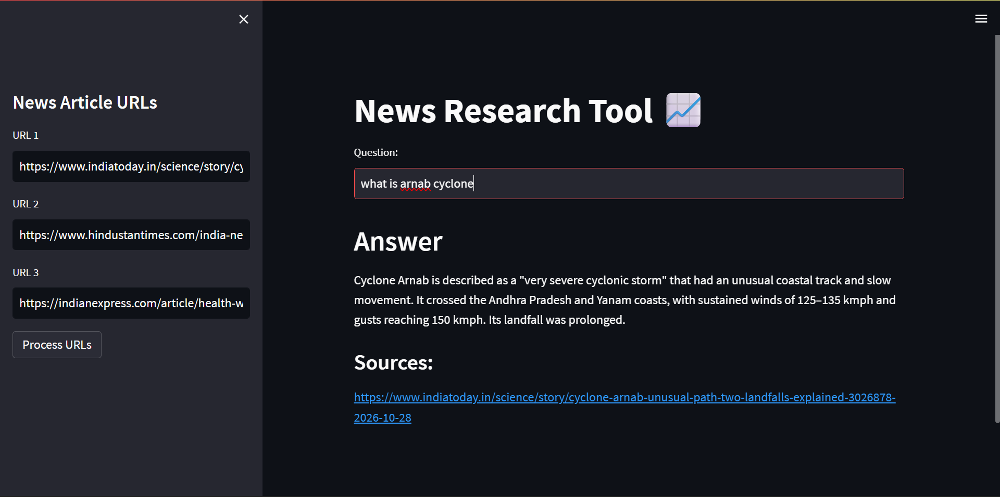

# News Research Tool 📈

News Research Tool is a user-friendly tool designed for effortless information retrieval. Users can input article URLs and ask questions to receive grounded, relevant insights and summaries based strictly on the provided articles.



## Features

- **Multi-URL Ingestion:** Load and parse web articles directly using LangChain's `UnstructuredURLLoader`.
- **Text Chunking:** Splits lengthy article texts into manageable chunks with `RecursiveCharacterTextSplitter`.
- **Gemini Embeddings & FAISS Vector Indexing:** Generates semantic vector embeddings using Google's `gemini-embedding-001` and indexes them with Meta's `faiss-cpu` for sub-second similarity retrieval.
- **Context-Grounded Q&A:** Queries Google's `gemini-2.5-flash` model using strict retrieval-augmented generation (RAG) prompts to prevent hallucinations.
- **Source Attribution:** Displays the source article links for fact-checking and validation.

---

## Installation

### 1. Clone the repository
```bash
git clone [https://github.com/supriyosuvam2344/news-research-tool.git](https://github.com/supriyosuvam2344/news-research-tool.git)
```
### 2. Navigate to the project directory

```bash
cd news-research-tool
```
### 3. Create and activate a virtual environment

```bash
# Windows
python -m venv venv
venv\Scripts\activate

# macOS/Linux
python3 -m venv venv
source venv/bin/activate
```
### 4. Install the required dependencies

```bash
pip install -r requirements.txt
```
### 5. Configure your Gemini API key
Create a .env file in the project root directory and add your Google Gemini API key:
```bash
GEMINI_API_KEY=your_gemini_api_key_here
```
## Usage/Examples

1. Run the Streamlit app by executing:
```bash
streamlit run main.py
```

Open the application in your browser (usually http://localhost:8501):

Enter up to 3 article URLs in the sidebar.

Click Process URLs to download the text, split it into chunks, compute embeddings, and build the local FAISS index.

Once processing finishes, enter your question into the Question input box.

View the generated answer along with the exact source article URLs.

- Example news articles to test:
  - https://www.indiatoday.in/science/story/cyclone-arnab-unusual-path-two-landfalls-explained-3026878-2026-10-28

  - https://www.hindustantimes.com/india-news/north-india-getting-hotter-drier-south-wetter-a-study-of-70-year-climate-trends-uncovers-worrying-climate-shift-101793248500727-amp.html

  - https://indianexpress.com/article/health-wellness/climate-change-worsening-heat-stress-disease-risks-india-lancet-report-10940258/lite/

## Project Structure

- main.py: The Streamlit application UI and RAG pipeline script.

- requirements.txt: Python package dependencies.

- faiss_store_gemini/: Local directory storing the saved FAISS vector store index and metadata.

- .env: Environment file storing your GEMINI_API_KEY.